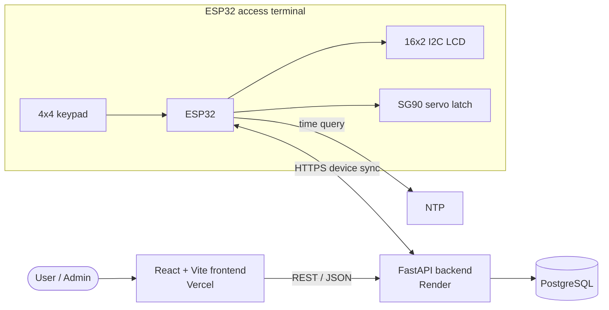

<div align="center">

# Digital Key Access Control

**Time-bound PIN access to shared physical resources, from a web app to an ESP32 keypad latch.**

[](https://digital-key-access-control.vercel.app/)
[](https://digital-key-backend-2qvp.onrender.com/docs)
[](https://www.postgresql.org/)
[](docs/hardware-setup.md)
[](https://digital-key-access-control.vercel.app/)
[](https://digital-key-backend-2qvp.onrender.com/health)

[Live Demo](https://digital-key-access-control.vercel.app/) · [Backend API](https://digital-key-backend-2qvp.onrender.com) · [Repository](https://github.com/santa0705/digital-key-access-control)

</div>

---

## Overview

Shared lockers, tool cabinets and lab equipment are usually protected by a physical key or a static code. Neither can be scoped to a person or a time window, and neither leaves a useful record.

Digital Key Access Control is a hardware-software system that manages access to shared physical resources. A web application handles resources and access workflows, a FastAPI backend backed by PostgreSQL holds the data and policy, and an ESP32-based terminal at the resource accepts a PIN on a keypad, shows feedback on an LCD, and drives a servo-operated latch.

The terminal synchronizes with the backend over HTTPS, obtains trusted time over NTP, and verifies the server's synchronization responses before using them. When those trust conditions are not met, it fails closed.

## Features

- **Digital access management.** A React web application for resource and access-related management workflows, deployed on Vercel.
- **ESP32 PIN terminal.** PIN entry on a 4×4 matrix keypad, with PIN validation and lockout behavior implemented in the firmware.
- **Servo-controlled physical latch.** An SG90 servo operates the latch; servo endpoints must be calibrated for each physical latch.
- **LCD feedback.** A 16×2 I²C LCD shows status to the person at the terminal.
- **Backend device synchronization.** The terminal exchanges data with the FastAPI backend through a dedicated device sync endpoint.
- **Trusted time and cryptographic verification.** NTP-based trusted time, HTTPS certificate validation, and cryptographic verification of synchronization responses. If required trust conditions are not satisfied, the terminal fails closed.
- **PostgreSQL-backed application data.** Application data is stored in PostgreSQL, with schema migrations managed through Alembic.

## Architecture



**Access flow**

1. A user requests access to a resource through the web application, and the request is processed by the backend.
2. The backend stores the data in PostgreSQL and makes the resulting credential information available to the terminal through device synchronization.
3. The ESP32 obtains trusted time over NTP and synchronizes with the backend over HTTPS, verifying the server's response.
4. At the physical resource, the user enters a PIN on the keypad; the firmware validates it and applies lockout rules.
5. If validation succeeds, the ESP32 drives the servo to operate the latch and shows the result on the LCD. If required trust conditions are not satisfied, access is refused.

See [`docs/architecture.md`](docs/architecture.md) for the full design.

## Technology Stack

| Layer | Technology | Purpose |
|---|---|---|
| Frontend | React, Vite, JavaScript | Web application for resource and access workflows |
| Frontend hosting | Vercel | Hosts the live frontend |
| Backend | Python, FastAPI | REST API and device synchronization endpoint |
| Data access | SQLAlchemy, Alembic | ORM and database migrations |
| Backend hosting | Render | Hosts the live backend API |
| Database | PostgreSQL | Persistent application data |
| Firmware | Arduino framework (ESP32) | Keypad input, PIN validation, lockout, sync, latch control |
| Display | `DIYables_LCD_I2C` library | 16×2 I²C LCD output |

## Hardware

The terminal is built from an ESP32 development board, a 4×4 matrix keypad, a 16×2 I²C LCD and an SG90 servo that operates the latch. The prototype does not use a separate RTC module, discrete status LEDs or an external buzzer.

| Component | ESP32 GPIO |
|---|---|
| Keypad rows | 19, 18, 5, 17 |
| Keypad columns | 23, 22, 21, 16 |
| LCD SDA | 26 |
| LCD SCL | 27 |
| Servo signal | 13 |

> **Power note:** the servo uses a separate 5 V supply, and its ground must be shared with the ESP32 (common ground). Servo endpoints need to be calibrated for the physical latch.

Wiring and assembly details are in [`docs/hardware-setup.md`](docs/hardware-setup.md).

## Project Structure

Paths below are limited to those referenced elsewhere in this README.

```text
digital-key-access-control/
|-- backend/                         FastAPI application
|-- frontend/                        React + Vite application
|-- firmware/
|   |-- esp32_sync_terminal.ino      ESP32 terminal firmware
|   |-- secrets.h.example            Template for local firmware secrets
|   \-- HARDWARE_NOTES.md
|-- docs/
|   |-- installation.md
|   |-- hardware-setup.md
|   |-- architecture.md
|   |-- api-contract.md
|   \-- credential-policy.md
|-- .env.example                     Template for local backend environment
\-- README.md
```

## Setup & Installation

**Prerequisites:** Python and pip, Node.js and npm, PostgreSQL, Git, and the Arduino IDE with ESP32 board support.

Clone the repository:

```bash
git clone https://github.com/santa0705/digital-key-access-control.git
cd digital-key-access-control
```

**Backend.** Create a virtual environment and install dependencies:

```bash
python -m venv .venv
# Linux/macOS: source .venv/bin/activate
# Windows:     .venv\Scripts\activate
pip install -r backend/requirements.txt
```

Configure the environment, run migrations and start the server by following [`docs/installation.md`](docs/installation.md).

**Frontend.**

```bash
cd frontend
npm install
npm run dev
```

**Firmware.**

1. Install ESP32 board support and the `DIYables_LCD_I2C` library in the Arduino IDE.
2. Copy `firmware/secrets.h.example` to `firmware/secrets.h` and fill in your own values.
3. Open `firmware/esp32_sync_terminal.ino`, select your ESP32 board and port, and upload.

The complete steps are in [`docs/installation.md`](docs/installation.md).

## Environment Variables & Secrets

`.env` and `firmware/secrets.h` are local-only files. Do not commit them. Start from the templates [`.env.example`](.env.example) and [`firmware/secrets.h.example`](firmware/secrets.h.example), and keep real credentials and cryptographic keys out of the repository.

## Security

- **TLS validation.** The firmware validates the backend's HTTPS certificate against the configured Google Trust Services Root R4 certificate.
- **Trusted time.** The terminal acquires time over NTP, and time-dependent checks depend on it.
- **Verified synchronization.** The firmware cryptographically verifies server synchronization responses before relying on them.
- **Fail closed.** If required trust conditions are not satisfied, the terminal does not grant access.
- **PIN handling.** PIN validation and lockout are implemented in the firmware.
- **Secrets.** Real keys and credentials live only in local files that are not committed.

This is a student project and has not had an independent security audit. These measures reduce risk; they are not a guarantee, and anyone with physical access to the terminal or its firmware should be treated as a threat. The credential and key design is described in [`docs/credential-policy.md`](docs/credential-policy.md).

## Documentation

| Document | Contents |
|---|---|
| [`docs/installation.md`](docs/installation.md) | Complete installation steps |
| [`docs/hardware-setup.md`](docs/hardware-setup.md) | Wiring and hardware assembly |
| [`docs/architecture.md`](docs/architecture.md) | System architecture |
| [`docs/api-contract.md`](docs/api-contract.md) | API contract |
| [`docs/credential-policy.md`](docs/credential-policy.md) | Credential and synchronization policy |
| [`firmware/HARDWARE_NOTES.md`](firmware/HARDWARE_NOTES.md) | Firmware hardware notes |

## Current Limitations

- Initial trusted-time acquisition requires network connectivity and NTP access.
- The current policy enforces one active key per resource.
- A complete advance-booking calendar is not implemented.

## Contributors

- Tripti Patel
- Sai Santosh
