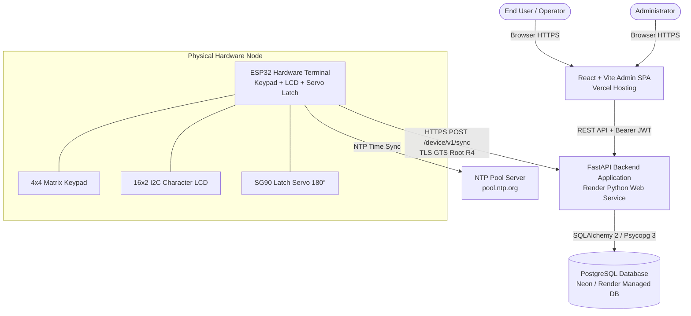
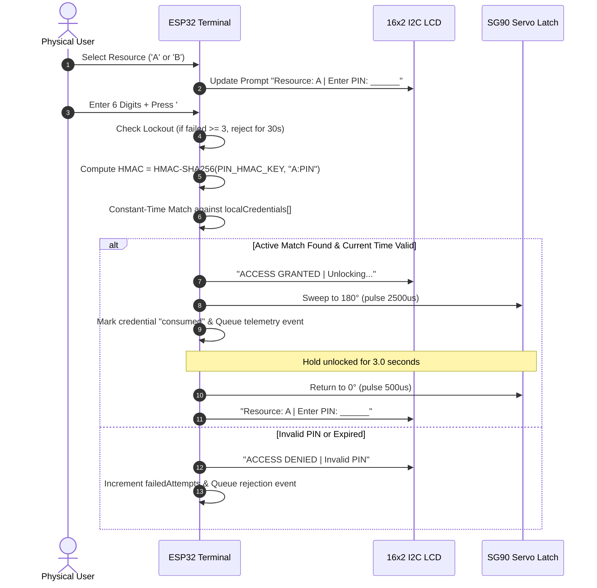
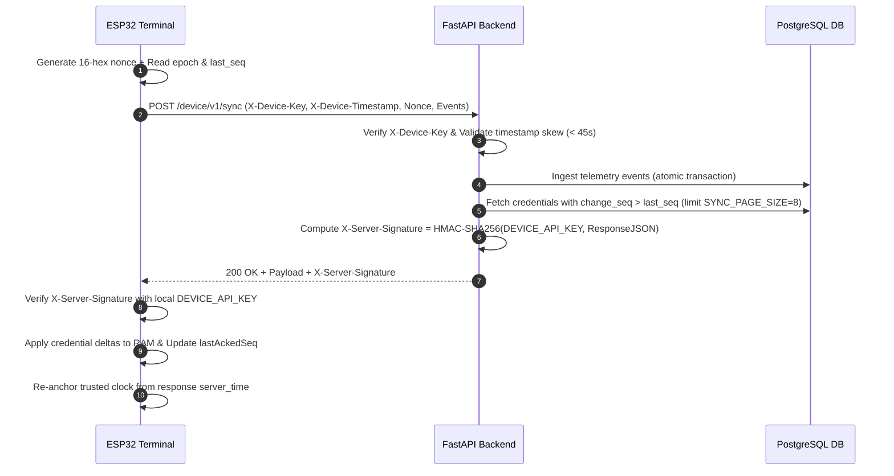

# Digital Key Access Control — System Architecture Specification

This document details the high-level architecture, module breakdown, security boundaries, and communication flows of the **Digital Key-Based Secure Access Control** system.

---

## 1. System Overview & Core Principles

The Digital Key Access Control platform bridges physical security hardware (keypad, LCD display, servo latch terminal) with a cloud-native management backend and administrator dashboard. It allows authorized users to request time-bounded access to shared physical resources (lockers, equipment cages, secure rooms) and receive cryptographically verified single-use or time-window digital PIN keys.

### 1.1 Architectural Principles
1. **Zero Plaintext PIN Storage:** PINs are never stored in plaintext. They are stored as keyed HMAC-SHA256 digests (`<resource_code>:<pin>`) for hardware verification, and encrypted using Fernet symmetric cryptography exclusively for authorized owner reveal.
2. **Offline-Capable Terminal Operation:** The ESP32 caches active credentials in local RAM and validates entries locally in real time without network round-trip latency. Access telemetry events are queued durably and batch-synchronized upon network restoration.
3. **Fail-Closed Clock Verification:** The terminal requires a trusted UTC time anchor (`server_anchored` via NTP and backend signed headers) to validate time-bounded credentials. If time synchronization expires or fails, the terminal refuses authorization.
4. **Strict Monotonic Change Sequence:** Every state change (issuance, revocation, expiry, consumption) increments a monotonically increasing 64-bit integer sequence (`change_seq`). Synchronization is strictly incremental, ensuring no missed events across unstable connections.
5. **Mutual Signature Verification:** Sync requests contain an anti-replay nonce and device timestamp signed by the client, and responses carry an HMAC-SHA256 signature in `X-Server-Signature` verified by the ESP32.

---

## 2. Component Breakdown

### 2.1 Physical Terminal Subsystem (ESP32 Firmware)
- **Target Microcontroller:** ESP32-WROOM-32 (240 MHz dual-core Tensilica Xtensa LX6, 520 KB SRAM, 4 MB Flash).
- **Physical Peripherals:**
  - **4×4 Matrix Keypad:** 8 GPIOs (4 row inputs with internal pull-ups `INPUT_PULLUP`, 4 column outputs strobed LOW).
  - **16×2 I²C Character LCD:** Powered by PCF8574 backpack connected to GPIO 26 (SDA) and GPIO 27 (SCL) driven by `DIYables_LCD_I2C`.
  - **SG90 Micro-Servo:** Actuates physical locker latch on GPIO 13 via 50 Hz PWM (`500 µs` = 0° locked, `2500 µs` = 180° unlocked).
- **Network & Cryptographic Engine:**
  - `WiFiClientSecure` with embedded Google Trust Services Root R4 certificate authority.
  - Hardware accelerated mbedTLS SHA-256 and HMAC routines.
  - In-RAM credential cache (up to 16 active records) and event queue (up to 20 telemetry events).

### 2.2 Backend Application Subsystem (FastAPI)
- **Framework:** FastAPI with Python 3.11+, asynchronous route handlers, Pydantic v2 schemas, and dependency injection.
- **ORM & Database Driver:** SQLAlchemy 2.0 with PostgreSQL native driver `psycopg` (binary version 3.1+).
- **Database Migrations:** Alembic with migration safety guard preventing execution against unauthorized target hosts.
- **Cryptographic Services:**
  - `PIN_HMAC_KEY`: 32-byte hexadecimal secret for HMAC-SHA256 validation digests.
  - `PIN_ENC_KEY`: 32-byte URL-safe base64 Fernet key for reversible PIN storage.
  - `DEVICE_API_KEY`: Shared secret for `X-Device-Key` and `X-Server-Signature` HMAC response signing.
  - `JWT_SECRET`: HS256 secret for session tokens.

### 2.3 Management Frontend Subsystem (React + Vite)
- **Build & Framework:** Vite 8+ with React 19 and React Router v7.
- **Design System:** Responsive desktop and mobile interface with `@fontsource/inter` typography and `lucide-react` icons.
- **Admin Capabilities:**
  - Resource status monitoring (Resource A & B occupancy and latch state).
  - Access request approval workflow with conflict detection and replacement prompts.
  - Active credential revocation and reveal.
  - Real-time audit log stream filtering server and device telemetry events.
  - Terminal node heartbeat and time synchronization monitoring.

---

## 3. Detailed Data Flow & Synchronization Protocol

### 3.1 Keypad Access Authentication Flow (Terminal Local)

### 3.2 Terminal to Backend Synchronization Protocol (`POST /device/v1/sync`)

---

## 4. Database Domain Models & Relationships

The relational schema comprises seven domain models managed under Alembic:

1. **`users`:** Identity store with email, bcrypt password hash, and role (`admin` or `user`).
2. **`resources`:** Managed physical assets (Resource A: Locker 1 with physical latch, Resource B: Locker 2 simulated).
3. **`nodes`:** Edge hardware nodes (terminal records, node code, firmware version, last heartbeat, time status).
4. **`sync_state`:** Atomic sequence counter maintaining monotonic `change_seq` and current epoch.
5. **`access_requests`:** Booking requests submitted by users with requested time window, status (`pending`, `approved`, `rejected`, `revoked`).
6. **`credentials`:** Cryptographic key records linked to approved requests (`pin_hmac`, `pin_encrypted`, `valid_from`, `valid_until`, `status`, `change_seq`, `revoke_reason`).
7. **`access_events`:** Unified audit trail for all events originating from the cloud server or hardware terminals.

---

## 5. Security & Threat Mitigation Controls

| Threat Vector | Mitigation Mechanism | Verification Location |
|---|---|---|
| **Eavesdropping on Wi-Fi** | End-to-end TLS 1.3 HTTPS with GTS Root R4 certificate pinned in ESP32 firmware flash. | `esp32_sync_terminal.ino:ROOT_CA` |
| **Man-in-the-Middle Sync Injection** | Backend HMAC-SHA256 signature header (`X-Server-Signature`) verified against `DEVICE_API_KEY`. | `esp32_sync_terminal.ino` & `services/sync.py` |
| **Replay Attacks on Terminal** | Dynamic 16-hex `request_nonce` paired with `X-Device-Timestamp` validation window. | `backend/app/deps.py` |
| **Credential Database Leakage** | PINs stored strictly as HMAC digests; plaintext recoverable only with external `PIN_ENC_KEY`. | `services/credentials.py` |
| **Keypad Brute-Force Attacks** | RAM-only lockout: 3 consecutive failed PIN attempts trigger a mandatory 30-second lockout. | `esp32_sync_terminal.ino:lockoutUntilMillis` |
| **Out-of-Order Delta Race Conditions** | Monotonic sequential numbering (`change_seq`) incremented via atomic database procedure. | `alembic/versions/0001_initial_schema.py` |
| **Clock Tampering / Expired Entry** | Multi-tier time anchoring requiring synchronized UTC timestamp to validate active window. | `deps.py` & `esp32_sync_terminal.ino` |
