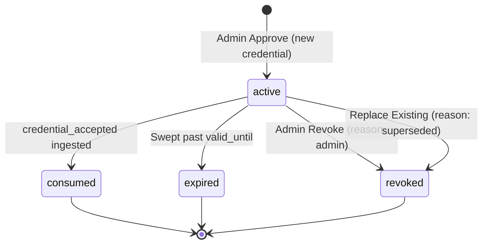
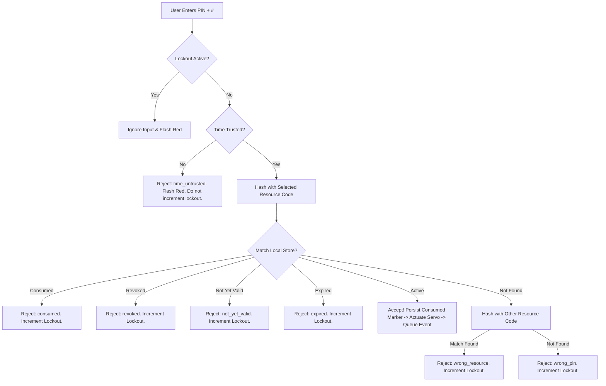

# Digital Key-Based Secure Access Control — Credential & Synchronization Policy

> **Document Status:** `contracts-v1 FINAL SPECIFICATION`<br>
> **Milestone:** Step 2 Sign-Off / `contracts-v1`<br>
> **Authors & Stakeholders:** Person A (Schema & Data Consistency) & Person B (Services & Security Policies)

---

## 1. Overview & Policy Principles

This document specifies the authoritative credential lifecycle, cryptographic rules, transaction boundaries, synchronization procedures, and device validation policies for the Digital Key-Based Secure Access Control system.

All behaviors defined here are binding across backend services (`services/credentials.py`, `services/sync.py`), database triggers, the mock device client, and the ESP32 terminal firmware.

---

## 2. Cryptographic Key Management & Verification

### 2.1 Keys & Secrets

| Key Name | Storage Location | Format | Purpose | Security Boundary & Ownership |
|---|---|---|---|---|
| `PIN_HMAC_KEY` | Server `.env` & Firmware `secrets.h` | 32-byte hexadecimal string | Keyed HMAC-SHA256 digest calculation for PIN verification | Shared secret between backend and authorized access terminals. Embedded in firmware flash on ESP32. |
| `PIN_ENC_KEY` | Server `.env` only | 32-byte URL-safe base64 string (Fernet key) | Symmetric encryption of PINs for repeatable owner retrieval | Strictly private to backend. **Never exposed to devices or Git.** Validated on server boot via `Fernet(PIN_ENC_KEY)`. |
| `DEVICE_API_KEY` | Server `.env` & Firmware `secrets.h` | 32-byte hexadecimal string | Shared device authentication & HMAC sync response signing | Shared secret for `X-Device-Key` request header and `X-Server-Signature` response signing. |
| `JWT_SECRET` | Server `.env` only | 32-byte hexadecimal string | Signing user/admin session tokens (HS256) | Strictly private to backend. |

### 2.2 PIN Generation & Canonical HMAC Calculation
1. **Format:** Exactly 6 decimal digits (`000000` to `999999`), zero-padded.
2. **Entropy:** Generated via cryptographically secure pseudo-random number generator:
   ```python
   import secrets
   pin = f"{secrets.randbelow(1_000_000):06d}"
   ```
3. **Resource Binding & Canonical Message Encoding:**
   The PIN is bound to a single uppercase resource code (`A` or `B`) prior to hashing:
   $$\text{message} = \text{\textless resource\\_code\textgreater} : \text{\textless pin\textgreater} \quad (\text{e.g., } \texttt{"A:482916"})$$
   - **Key bytes:** Raw UTF-8 bytes of `PIN_HMAC_KEY`.
   - **Message bytes:** Raw UTF-8 bytes of `message`.
   - **Digest output:** Exactly 64 lowercase hexadecimal characters.
   $$\text{pin\\_hmac} = \text{HMAC-SHA256}(\text{PIN\\_HMAC\\_KEY}, \text{message}).\text{hexdigest}()$$
   *Consequence:* A PIN issued for Resource A produces a completely different digest than the same digits entered for Resource B.
4. **Reversible Storage (Fernet):**
   ```python
   from cryptography.fernet import Fernet
   cipher = Fernet(PIN_ENC_KEY.encode())
   pin_encrypted = cipher.encrypt(pin.encode("utf-8")).decode("utf-8")
   ```
   *Fernet Key Generation Command:*
   ```bash
   python -c "from cryptography.fernet import Fernet; print(Fernet.generate_key().decode())"
   ```
5. **Collision Handling:**
   A unique constraint protects `(resource_id, pin_hmac)` across all statuses. If a collision occurs upon creation, generation retries up to 5 times.

### 2.3 Official Cryptographic Test Vectors

#### Test Vector 1: PIN HMAC-SHA256 (Cross-Platform Verification)
Both Python unit tests and the ESP32 firmware boot sequence must verify this exact test vector:
- **Test Secret Key:** `dkac-test-vector-key-0001`
- **PIN:** `482916`
- **Resource A Test:**
  - Message: `A:482916`
  - Digest: `e48f878502a47172ea00cf018627956dab95a5073357dc5b01220bc4179093bc`
- **Resource B Test:**
  - Message: `B:482916`
  - Digest: `ed29df457234511590c7bc93b50d72e12d91ef377ff1fa0e81245087c0e937ca`

#### Test Vector 2: Sync Response HMAC-SHA256 (`X-Server-Signature`)
Used by Person B (`services/sync.py`) and Person A (`sync_client.cpp`) to verify response signing:
- **Test Device API Key:** `dkac-device-test-key-0001`
- **Canonical Response Body Bytes:**
  ```json
  {"server_time":"2026-10-12T09:15:02Z","request_nonce":"c4b8e21a8f9042b7"}
  ```
- **Expected `X-Server-Signature`:**
  `c9c1a47b519b81ab2d9423dc9f6d57b379da7d2ef35326212ef9ccba6f972022`

---

## 3. Credential Lifecycle & State Machine



### 3.1 Terminal Immutability Rule
The states `consumed`, `expired`, and `revoked` are strictly **terminal**:
- A terminal credential can **never** transition back to `active` or to any other status.
- Once terminal, a credential's core identity fields (`status`, `resource_id`, `request_id`, `pin_hmac`, `pin_encrypted`) cannot be modified.
- Terminal credential rows cannot be deleted from the database.
- Enforced at three levels:
  1. Service layer guarded updates (`UPDATE credentials SET status = :new WHERE status = 'active'`).
  2. Database trigger (`trg_credentials_terminal_immutability`) preventing illegal status mutations, validity alterations on non-active rows, identity alterations on terminal rows, and deletion of terminal credentials.

  3. Device local merge logic (Rule DR-4: local terminal markers can never be overwritten by incoming server sync packets).

### 3.2 Single Active Credential Policy (Rule R1)
At most **one** credential per resource may hold `status = 'active'` at any given moment:
- Backed in PostgreSQL by a partial unique index:
  ```sql
  CREATE UNIQUE INDEX uq_credentials_resource_active
  ON credentials (resource_id)
  WHERE status = 'active';
  ```
- **Scope & Limitations (Deferred Multi-Booking Calendar):**
  - A multi-booking calendar allowing advance scheduling of multiple non-overlapping windows is **deferred beyond the student MVP**.
  - In MVP, approvals should only be granted for the currently imminent booking window.
- **Replacement Behavior (`replace_existing`):**
  - If an admin attempts to approve a request for Resource A while an active credential already exists:
    - If `replace_existing` is `false` (default): Fails with `409 active_credential_exists`.
    - If `replace_existing` is `true`: The existing active credential is atomically revoked (`revoke_reason: "superseded"`), its parent request is marked `status = 'revoked'`, and the new credential is issued in the same transaction.
    - *UI Requirement:* The Admin UI must display a clear confirmation modal explicitly warning that confirming replacement will immediately revoke the current active credential.

### 3.3 Change-Sequence Allocation on Every Transition
Every credential insert or status modification must increment `change_seq` via `next_change_seq()`:
- `active` inserted → new `change_seq`.
- `active` → `consumed` → new `change_seq`.
- `active` → `expired` (sweep) → new `change_seq`.
- `active` → `revoked` (admin or replacement) → new `change_seq`.
*Result:* Terminal delta syncs (`last_seq`) will never miss an expiration or revocation.

---

## 4. Transaction Boundaries & Lock Ordering

To eliminate database deadlocks under concurrent admin actions and high-frequency device synchronization, all database transactions must acquire row locks in this **strict order**:

$$\mathbf{Resource} \longrightarrow \mathbf{AccessRequest} \longrightarrow \mathbf{Credential} \longrightarrow \mathbf{SyncState}$$

### 4.1 Transactional Operations Breakdown

| Operation | Steps Executed in Single Transaction | Failure Rollback Behavior | Idempotency / Retries |
|---|---|---|---|
| **Approve (+ Replace)** | 1. Lock resource row.<br>2. Lock access request.<br>3. Sweep expired rows for resource.<br>4. Validate `status == 'pending'` and `end_at > now`.<br>5. Check Rule R1: if active exists and `replace_existing: true`, set old credential to `revoked` (`superseded`) and old request to `revoked`.<br>6. Insert new credential with new `change_seq`.<br>7. Update request to `approved`.<br>8. Record audit events (`request_approved`, `credential_issued`, optional `credential_replaced`).<br>9. Commit. | Full rollback: request stays pending, counter unchanged, no partial rows. | If commit succeeded but response timed out, retry returns `409 invalid_state`. |
| **Reject** | 1. Lock access request.<br>2. Update request `status = 'rejected'`.<br>3. Record `request_rejected` audit event.<br>4. Commit. | Full rollback: request remains pending. | Retry returns `409 invalid_state`. |
| **Revoke** | 1. Lock credential row.<br>2. Require `status == 'active'`.<br>3. Set `status = 'revoked'`, `revoke_reason = 'admin'`.<br>4. Set parent request to `status = 'revoked'`.<br>5. Increment `change_seq = next_change_seq()`.<br>6. Record `credential_revoked` audit event.<br>7. Commit. | Full rollback: credential stays active. | Retry returns `409 invalid_state`. |
| **Expire Sweep** | 1. For each row: `UPDATE credentials SET status = 'expired', change_seq = next_change_seq() WHERE status = 'active' AND valid_until <= now()`.<br>2. Record `credential_expired` event.<br>3. Commit. | Unaffected rows remain active; subsequent sweep will retry. | Safe and idempotent. |
| **Event Ingestion (Sync)** | 1. `INSERT INTO access_events ... ON CONFLICT (event_id) DO NOTHING`.<br>2. For stale-epoch / unknown credentials: insert with `credential_id = NULL` and `note = 'unknown_credential'`.<br>3. For newly inserted `credential_accepted` events, guarded update credential to `consumed` with `change_seq = next_change_seq()`.<br>4. Record server audit rows.<br>5. Commit. | Rollback whole batch: nothing consumed, events not acknowledged. Device resends queue. | Safe against network duplication. Events only acked in response after durable commit. |
| **Reveal PIN** | 1. Verify caller owns request (`user.id == request.user_id`). Admins forbidden (`403`).<br>2. Verify credential is active.<br>3. Decrypt PIN using Fernet.<br>4. Insert `pin_revealed` audit event.<br>5. Commit. If audit fails, return HTTP 500 without PIN. | Rollback: no PIN disclosed. | Repeatable for credential owner. Returns `Cache-Control: no-store, private`. |

---

## 5. Synchronization Contract (`/device/v1/sync`)

### 5.1 Monotonic Sequence Model
- Sequence numbers (`change_seq`) originate strictly from the single row in `sync_state`:
  ```sql
  UPDATE sync_state SET current_seq = current_seq + 1 WHERE id = 1 RETURNING current_seq;
  ```
- Because row locks are held until commit, commits happen in strict sequence order without gaps. A reader snapshot in `REPEATABLE READ` isolation guarantees contiguous changes.
- `epoch`: UUID assigned on database initialization or reset. If a terminal sends an epoch that does not match server `epoch`, the server orders a full resync.

### 5.2 Device Rules (DR-1 through DR-8)
- **DR-1 (NVS Dual-Slot Storage):** Terminal stores credentials in dual-slot NVS storage with CRC32 integrity check. Capacity: ≤ 16 credentials, ≤ 32 consumed markers, ≤ 100 queued events.
- **DR-2 (Persisted Sequence):** Request carries persisted `last_seq`. It never advances using an uncommitted or RAM-only value.
- **DR-3 (Response Signature & Freshness Validation):**
  The device verifies incoming response before processing:
  1. Header `X-Server-Signature` must equal `hex(HMAC-SHA256(DEVICE_API_KEY, response_body_bytes))`.
  2. `response.request_nonce` must equal the random 16-hex nonce generated by the device for this request.
  3. `change_seq` in incoming delta must be strictly ascending within `(from_seq, to_seq]`.
  4. If any verification fails: **discard entire response**. Persist nothing to NVS, advance no sequence pointers, evict no queued events, and retry with backoff.
- **DR-4 (Delta Merge Rule):** Ignore credential record if incoming `change_seq <= stored change_seq`. Local consumed markers and local terminal states **never** get overwritten by an `active` state.
- **DR-5 (Full Resync Rule):** When `full_resync == true` or epoch changes, replace local store with server snapshot. If epoch changed, purge old consumed markers.
- **DR-6 (Atomic Commit before Ack):** The device writes updated credentials and new sequence pointer to NVS **before** acknowledging the sequence in the subsequent sync request.
- **DR-7 (Event Queue Management & Circular Eviction):** Device queues events in NVS. If queue reaches limit (100 events):
  1. Oldest `pin_rejected` events are dropped first.
  2. If space is still needed, oldest `lockout_started` events are dropped.
  3. `credential_accepted` and `unlock_command_issued` events are **never dropped**. If the buffer fills exclusively with non-droppable events, new entries fail closed.
- **DR-8 (Transport & Heartbeat):** Plain HTTP POST with timeout 5 seconds. Terminal heartbeats every 15 seconds while online. Retry backoff: 2s, 4s, 8s, up to 60s. Response must carry valid `X-Server-Signature`.

---

## 6. Device Validation Sequence & Hardware Lockout

When a user enters a 6-digit PIN on the 4x4 keypad, the terminal executes validation in this exact deterministic order:



### 6.1 Failed Attempts & Lockout Rules
1. **Lockout Trigger:** 3 consecutive failed attempts (reasons: `wrong_pin`, `wrong_resource`, `expired`, `not_yet_valid`, `consumed`, `revoked`).
2. **Lockout Duration:** 30 seconds.
3. **Lockout Behavior:** During lockout, all keypad entries are ignored, the red LED stays solid, and a `lockout_started` event is queued.
4. **Exception:** Rejections due to `time_untrusted` do **not** increment the failure counter.
5. **RAM Storage Trade-Off:** The failure counter is kept in volatile RAM to prevent flash memory burnout from write wear. Resetting or power-cycling the terminal clears the counter (accepted prototype limitation).

### 6.2 Fail-Closed Consume-Before-Actuate Trade-Off
The terminal persists the consumed marker to NVS *before* commanding the servo latch:
- **Failure Case:** If power is cut after the NVS write but before the servo moves, the PIN is burned and the locker remains locked. Re-entering the PIN returns `consumed`.
- **Rationale:** Moving first and recording after would create a race window where cutting power after unlock permits infinite PIN re-use. The fail-closed approach protects physical security. Admins can view logs (`credential_accepted` without `unlock_command_issued`) and re-issue a credential.

---

## 7. Time Trust Policy & Tiers

| Tier | Operating Mode | Clock Source | Validation Trust Window | Status |
|---|---|---|---|---|
| **Tier 1** | Web / Backend | Server System Clock (UTC) | Authoritative server clock. | Active |
| **Tier 2** | Mock Device | Injected test clock parameter | Deterministic test harness simulation. | Active |
| **Tier 3** | Physical Online-First | Synced server timestamp (`server_time`) + internal millis elapsed | Valid while anchor age ≤ `TIME_ANCHOR_MAX_AGE_S` (configurable; **MVP default: 90 seconds**). If expired, terminal marks time `untrusted` and rejects PIN entries fail-closed. | **Authoritative Baseline** |
| **Tier 4** | Optional Offline RTC | HW-111 (DS1307 + AT24C32N) | Battery-backed hardware clock. | **DISABLED FOR SPRINT** *(Hazard: 5V logic & charging circuit)* |

### 7.1 Tier 3 Trade-Off: Anchor Max Age (`TIME_ANCHOR_MAX_AGE_S = 90s`)
- **Default Baseline:** 90 seconds (6 heartbeats at 15s interval).
- **Security Implications:**
  - **Fail-Closed Stale Time:** If the terminal loses Wi-Fi for > 90 s, all PIN attempts are rejected fail-closed with `time_untrusted` (rapid red LED blink; no servo actuation).
  - **Revocation Delay Window:** Revocation cannot be instantaneous while a terminal is disconnected. If an admin revokes a credential, a disconnected terminal will continue to honor the active PIN until its next successful sync or until the 90-second anchor expires.

---

## 8. Security Assumptions, Prototype Boundaries & Deferred Features

1. **PIN Entropy:** 6-digit PINs offer $10^6$ combinations. Protection relies on 3-failure / 30-second lockout and time-bounded validity windows.
2. **Firmware Keys:** `PIN_HMAC_KEY` and `DEVICE_API_KEY` are stored in terminal flash. Physical memory extraction can expose them.
3. **Transport Security:** Prototype operates over trusted private Wi-Fi without TLS (`http://`). Multi-machine demonstrations should utilize HTTPS/TLS reverse-proxies.
4. **Physical Sensing:** Actuation emits `unlock_command_issued`, not physical confirmation of door opening (no reed switch position sensor on prototype).
5. **Deferred Beyond Student MVP:**
   - Multi-booking calendar with advance scheduling of future non-overlapping windows.
   - Per-device unique private keys and asymmetrical public-key device enrollment.
   - Hardware-secure flash encryption (ESP32 Secure Boot and Flash Encryption).
   - DS1307 RTC battery-backed offline operation.
